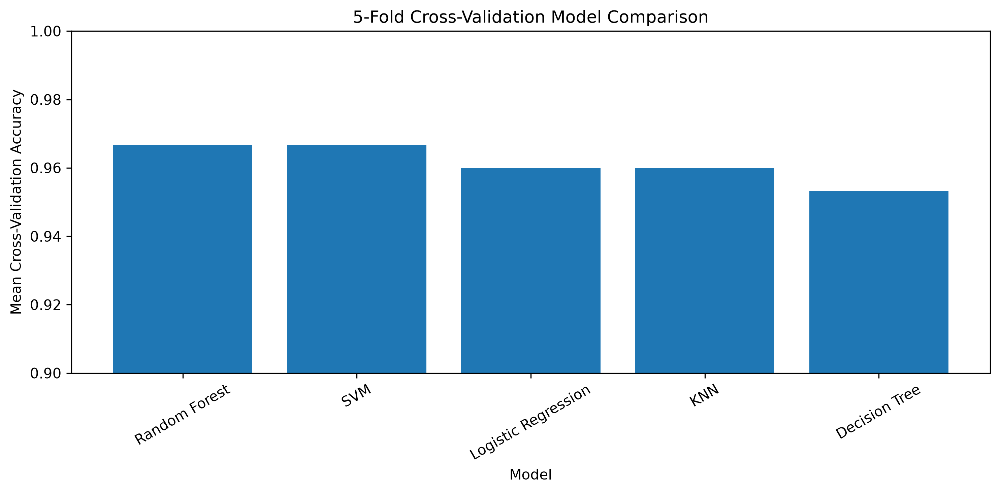
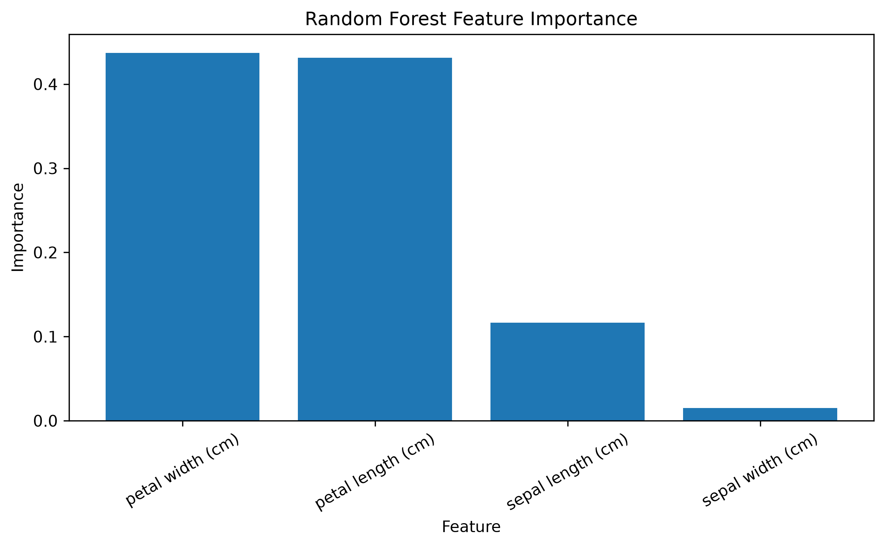

# Iris Classification

A machine learning classification project using the Iris dataset from Scikit-learn.

This project compares five classification algorithms and evaluates their performance using both a train-test split and 5-fold cross-validation.

## Project Overview

The goal of this project is to classify Iris flowers into three species based on their sepal and petal measurements.

The project demonstrates a complete machine learning workflow:

* Dataset loading
* Data exploration
* Missing-value checking
* Train-test splitting
* Feature scaling
* Model training
* Model evaluation
* 5-fold cross-validation
* Model comparison
* Feature importance analysis

## Dataset

The Iris dataset contains measurements of Iris flowers from three different species:

* Setosa
* Versicolor
* Virginica

### Features

* Sepal length (cm)
* Sepal width (cm)
* Petal length (cm)
* Petal width (cm)

### Target

The target variable represents the Iris flower species.

The dataset is loaded directly from Scikit-learn, so no separate dataset file is required.

## Machine Learning Models

Five classification algorithms were trained:

1. Logistic Regression
2. K-Nearest Neighbors (KNN)
3. Decision Tree
4. Support Vector Machine (SVM)
5. Random Forest

Feature scaling was applied where appropriate using Scikit-learn Pipelines.

## Model Evaluation

The models were evaluated using 5-fold cross-validation.

| Model               | Mean CV Accuracy |
| ------------------- | ---------------: |
| Random Forest       |           96.67% |
| SVM                 |           96.67% |
| Logistic Regression |           96.00% |
| KNN                 |           96.00% |
| Decision Tree       |           95.33% |

Random Forest and SVM achieved the highest mean cross-validation accuracy in this experiment, with both reaching **96.67%**.

### Cross-Validation Comparison



## Feature Importance

Random Forest feature importance was used to examine the contribution of each feature to the trained model.

| Feature           | Importance |
| ----------------- | ---------: |
| Petal width (cm)  |     43.72% |
| Petal length (cm) |     43.15% |
| Sepal length (cm) |     11.63% |
| Sepal width (cm)  |      1.50% |

Petal width and petal length had the highest importance in the trained Random Forest model, while sepal width had the lowest importance.

### Feature Importance Visualization



## Technologies Used

* Python
* Pandas
* Matplotlib
* Scikit-learn
* Jupyter Notebook

## Project Structure

```text
iris-classification/
│
├── iris_classification.ipynb
├── README.md
├── requirements.txt
├── .gitignore
│
└── images/
    ├── cv_comparison.png
    └── feature_importance.png
```

## How to Run

Clone the repository and install the required packages:

```bash
pip install -r requirements.txt
```

Then open the Jupyter Notebook:

```text
iris_classification.ipynb
```

Run the notebook cells to reproduce the analysis, model training, evaluation, and visualizations.

## Conclusion

This project demonstrates a complete machine learning classification workflow using the Iris dataset.

Five classification algorithms were trained and compared using 5-fold cross-validation. Random Forest and SVM achieved the highest mean cross-validation accuracy of 96.67% in this experiment.

The project also demonstrates how feature importance can be used to understand which features contributed most to a Random Forest model's predictions.

Overall, the project covers the complete process from data exploration and preprocessing to model evaluation, cross-validation, comparison, and interpretation.
